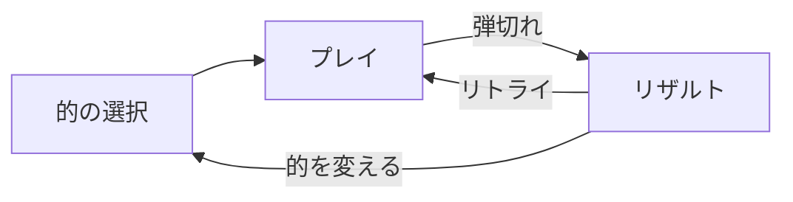
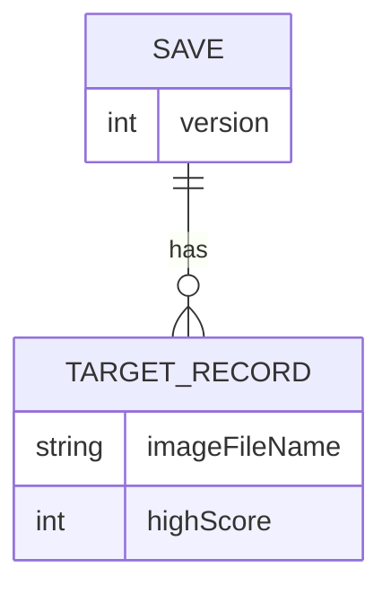

# 的当てシミュレーション(Unity)

## 1. 概要
- 目的: 物理シミュレーションの学習を兼ねた、的当てゲームを作る。
- 想定ユーザー: 自分(個人用・学習用)。最終的にスマホで遊べるようにする。
- 解決する課題: Unityの物理(Rigidbody / Collider / 力 / 衝突)を、遊べる形で段階的に理解する。
- 一言で言うと: **好きな画像を的にして、球を投げて当てた位置で得点が決まるゲーム。**
- 最終ゴール: 実行中に読み込んだ画像の**輪郭に合わせた的**を作り、最終的に**立体的な的**にする。

## 2. スコープ
### MVP(必須)
- [ ] 球を発射できる(ドラッグで狙い、離して発射。マウス/タッチ共通)
  - 完了条件: 角度と強さを変えて撃て、放物線で飛ぶ。
- [ ] 固定の的(単純な板)に当たり、**当たった位置で得点**が入る(中心ほど高得点)
  - 完了条件: 同じ位置に当てると同じ得点になる。1発につき得点は1回だけ。
- [ ] 残り弾数の制限、合計スコア表示、終了(リザルト)
### 次の段階(Should)
- [ ] 実行中に画像ファイルを読み込み、**画像の輪郭に合わせた平面の的**を生成する
- [ ] 的が動く・倒れる(動的な的)
### 最終ゴール(Could)
- [ ] 輪郭の的を**立体(厚み・押し出し)**にする
- [ ] スマホ(iOS/Android)ビルドと、端末の写真からの画像読み込み
- [ ] ハイスコア保存

### やらないこと(Non-Goals)
- オンラインランキング、マルチプレイ、課金・広告
- 画像のAI生成、他人の画像の配信・共有
- 厳密な物理シミュレーション(研究用途の精度は目指さない。体感の良さを優先)

## 3. ユーザーと権限
| ロール | できること | 認証 |
|---|---|---|
| プレイヤー(自分のみ) | 全操作 | なし(ローカル単体アプリ) |

## 4. ユーザーストーリー
- プレイヤーとして、角度と強さを調整して球を撃ちたい。狙った通りに飛ぶ手応えが欲しいから。
  - 受け入れ条件: ドラッグ量が大きいほど強く飛ぶ。上限がある。
- プレイヤーとして、的の中心に当てるほど高得点にしたい。狙う意味が出るから。
  - 受け入れ条件: 得点帯(例: 中心100 / 中間50 / 外周10 / 外れ0)が設定で変えられる。
- プレイヤーとして、好きな画像を的にしたい。自分だけのステージで遊べるから。
  - 受け入れ条件: 透過PNGなら、透明部分は的に含まれず、当たり判定は輪郭に沿う。

## 5. 画面設計
ローカルゲームのため API はなし。「画面」はUI(uGUI)の状態で表す。
### 5.1 画面一覧
| ID | 画面名 | シーン | 概要 |
|---|---|---|---|
| S1 | プレイ画面 | `Game` | 狙う・撃つ・得点表示(HUD) |
| S2 | 的の選択 | `Game`内パネル | 画像の読み込み・的の生成(段階2) |
| S3 | リザルト | `Game`内パネル | 合計スコア、リトライ |

### 5.2 画面遷移


### 5.3 画面詳細
#### S1 プレイ画面
- 目的: 球を撃って得点する。
- 主要コンポーネント: カメラ、発射台、的、HUD(スコア・残り弾数)、狙いの軌道ガイド(任意)
- 操作: ポインタ(マウス/タッチ)を押す→ドラッグで狙い・強さを決定→離すと発射。
- 状態: 通常 / 発射後の待機(球が止まるか一定時間で次弾) / 弾切れ→S3
- 入力値の制約: 発射の強さは `minPower`〜`maxPower` にクランプする。
#### S2 的の選択(段階2)
- 操作: 画像ファイルを選ぶ → プレビュー → 「この的で遊ぶ」
- 入力検証: 形式は PNG/JPG のみ、ファイルサイズ・解像度に上限(下記10章)。読み込み失敗時はエラー表示して元の的に戻す。
#### S3 リザルト
- 表示: 合計スコア、命中数。ボタン: リトライ / 的を変える

## 6. API 設計
外部 API はなし(単体ゲーム)。内部の主要インターフェースは9章を参照。

## 7. データモデル
### 7.1 設定データ(ScriptableObject)
#### `ScoreRingConfig`
| フィールド | 型 | 説明 |
|---|---|---|
| rings | `(float maxNormalizedDistance, int points)[]` | 中心からの正規化距離(0〜1)ごとの得点。距離の昇順 |
| missPoints | int | 的に当たらなかった場合(通常0) |
#### `ShooterConfig`
| フィールド | 型 | 説明 |
|---|---|---|
| minPower / maxPower | float | 発射の強さの範囲 |
| ammoCount | int | 1ゲームの弾数 |
| projectileMass | float | 弾の質量 |

### 7.2 保存データ(段階3以降・JSON)

- 保存先: `Application.persistentDataPath`。画像そのものはコピーして保存する想定(元ファイルのパスに依存しない)。

## 8. 技術スタック
| 領域 | 採用技術 | バージョン | 選定理由 |
|---|---|---|---|
| エンジン | Unity | 6000.6.6f1 | 導入済み |
| 描画 | URP(Universal 3D) | 17.6.0 | テンプレート標準 |
| 入力 | **Input System(新方式のみ有効)** | 1.20.0 | `activeInputHandler: 1`。旧 `UnityEngine.Input` は**使えない** |
| UI | uGUI | 2.6.0 | 導入済み |
| 物理 | 3D物理(PhysX)を一貫して使う | - | 2D物理と3D物理は干渉しないため混在させない |
| 画像読込 | ImageConversion / UnityWebRequestTexture | モジュール | 導入済み |
| テスト | Unity Test Framework | (要確認) | 純C#ロジックのEditModeテスト |
| エディタ | Zed 等の外部エディタ + Claude | - | 補完は弱い前提 |

## 9. アーキテクチャとディレクトリ構成
### 方針
- 物理・Unity API に依存しない**純C#のロジック**(輪郭抽出・得点計算)と、MonoBehaviour(接着役)を分ける。前者は自動テストできるようにする。
### ディレクトリ(`Assets/` 以下)
```
Assets/
  Scripts/
    Gameplay/   Shooter.cs, Projectile.cs, GameManager.cs, ScoreCalculator.cs
    Targets/    TargetBuilder.cs, ContourExtractor.cs, MeshBuilder.cs, Target.cs
    UI/         HudView.cs, ResultView.cs, TargetSelectView.cs
    Config/     ScoreRingConfig.cs, ShooterConfig.cs
  Tests/EditMode/   ScoreCalculatorTests.cs, ContourExtractorTests.cs
  Prefabs/  Scenes/  Settings/(既存)
```
### 主要コンポーネント
| 名前 | 責務 |
|---|---|
| `Shooter` | ポインタのドラッグから方向と強さを算出し、球を生成して `AddForce(Impulse)` |
| `Projectile` | 衝突を検知して `Target` に通知。1発につき得点は1回まで |
| `Target` | 当たった位置(ワールド座標)を的のローカル座標→正規化距離へ変換 |
| `ScoreCalculator`(純C#) | 正規化距離 → 得点(`ScoreRingConfig` を使う) |
| `ContourExtractor`(純C#) | 画像のアルファ値から輪郭点列を作る(しきい値→境界追跡→簡略化) |
| `MeshBuilder`(純C#) | 輪郭点列 → 三角形分割 → 平面メッシュ(最終的に押し出して立体化) |
| `TargetBuilder` | 画像 → メッシュ+Collider+マテリアルを持つ的のGameObjectを生成 |

### 的の物理の方針(重要)
- 段階1: 平らな的(固定)。段階2: 輪郭メッシュ+**非凸 `MeshCollider`**(静止/Kinematicの的でのみ使える)。
- **動く(動的Rigidbody)的は、`MeshCollider` を凸(convex)にする必要がある**(三角形数にも上限あり)。輪郭が凹んだ形でも動かしたい場合は、凸な部品に分割するか、複数の単純なColliderで近似する。→未決事項参照。
- 弾は高速になりやすいので、`Collision Detection = Continuous Dynamic` にして、すり抜けを防ぐ。
- 速度は Unity 6 の `Rigidbody.linearVelocity` を使う(`velocity` は非推奨)。

## 10. 非機能要件
- 画像読み込み(外部ファイルは信頼しない):
  - 許可形式: PNG / JPG。サイズ上限(例: 10MB)と解像度上限(例: 長辺2048px。輪郭抽出前に512px程度へ縮小)を設ける。
  - 失敗(破損・巨大・非対応形式)は例外でクラッシュさせず、エラー表示して復帰する。
  - 画像・個人情報を外部へ送らない。通信は行わない。
- パフォーマンス: PC 60fps、スマホ 30fps以上。輪郭抽出は画像サイズに応じて重いので、段階的に最適化する。
- 対応端末: 段階1〜2はMacエディタ+PCビルド。段階3でスマホ(iOS/Android)。スマホのファイル選択・写真アクセスにはネイティブ連携が必要(Unity標準にはない。プラグインは導入時に選定)。
- 入力: マウスとタッチを `Pointer` 系で統一して扱い、端末分岐を増やさない。

## 11. 開発ルール
- セットアップ: Unity Hub でこのフォルダを開く。エディタは `6000.6.6f1`。
- **Claudeの作業範囲**: `Assets/Scripts/` と `Assets/Tests/` のC#の作成・編集が中心。
  - `.unity` / `.prefab` / `.asset` / `.meta` は**手で編集しない**(YAMLでGUID参照が壊れやすい)。シーン上の配置・コンポーネントの付与・Prefab作成は、手順を書いてユーザーがエディタで行う。
  - コンパイルの確認はUnityのConsoleで行う。エラーが出たらユーザーが内容を貼る。
- 入力は新Input Systemを使う(`UnityEngine.InputSystem`)。`Input.GetAxis` / `Input.GetKey` は使わない。
- 物理の処理は `FixedUpdate`、入力の読み取りは `Update`。
- 命名: C#は標準的なPascalCase(型・メソッド)/camelCase(フィールド)。識別子は英語、コメント・コミット・Issueは日本語。
- テスト方針: 純C#ロジック(`ScoreCalculator`、`ContourExtractor`、`MeshBuilder`)は EditMode テストを必ず書く。物理の挙動はPlayModeでの手動確認でよい。
- Git:
  - 管理するのは `Assets/`、`Packages/`、`ProjectSettings/`(`.meta` を含む)。`Library/`、`Temp/`、`Logs/`、`UserSettings/`、`obj/`、`Build/`、`*.csproj`、`*.sln` は `.gitignore` で除外。
  - 開発フロー(Issue駆動・`Kan-O435`・ブランチ `issue-<番号>`)は `~/.claude/CLAUDE.md` に従う。リポジトリ名: TODO。
- 秘密情報: 現状なし。将来プラグイン等でキーが必要になった場合はコミットしない。

## 12. 実装ロードマップ
1. **フェーズ1: 基本の的当て** — 床・固定の的(板)・球・発射(ドラッグ)・当たった位置での得点・弾数・リザルト
2. **フェーズ2: 画像の的(平面)** — ファイル読込 → アルファから輪郭抽出 → 平面メッシュ+Colliderの的を生成 → 輪郭内の位置で得点
3. **フェーズ3: 動く的** — 動的Rigidbody化(凸分割/近似)、倒れる・揺れる
4. **フェーズ4: 立体化** — 輪郭メッシュの押し出し(厚み)、側面・背面のマテリアル
5. **フェーズ5: スマホ対応** — タッチ最適化、モバイルビルド、端末の写真からの読み込み、保存データ

## 13. 未決事項・仮定
- **仮定**: 的は最初は固定、あとから動かす。得点は「的の中心からの正規化距離」で決める。
- **仮定**: 的の中心は、画像の不透明ピクセルの重心とする(幾何中心ではなく重心。偏った形でも自然に狙える)。
- 未決: 凹んだ輪郭の的を動的にする方法(凸分割 / 近似Collider / 動かさない)。
- 未決: 立体化の仕方(単純な押し出し / 縁を丸める / 画像の明度から高さを作る)。
- 未決: スマホでの画像選択プラグイン(PCでの実行中ファイル選択も、Unity標準にはないため、PC側は専用フォルダ(`persistentDataPath/Targets`)に置いた画像を一覧から選ぶ形で始めるのが簡単)。
- 未決: 得点帯の具体値、弾数、ゲームの終了条件(弾切れのみか、的を全部倒すか)。
- 未決: Unity Test Framework のバージョン(`Packages/manifest.json` で確認する)。
